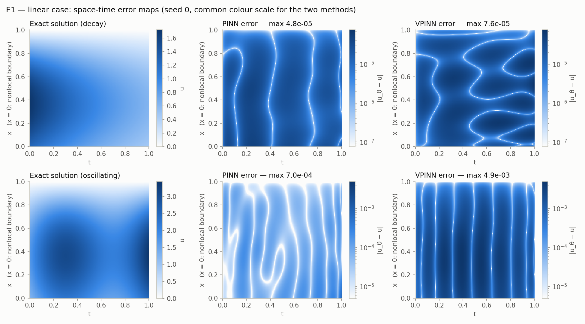
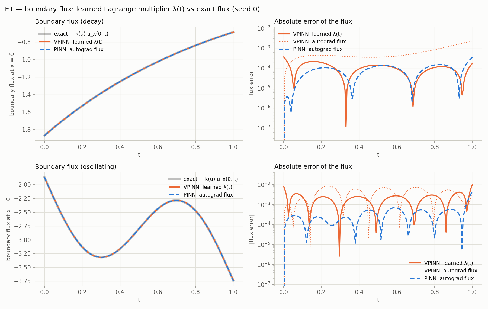
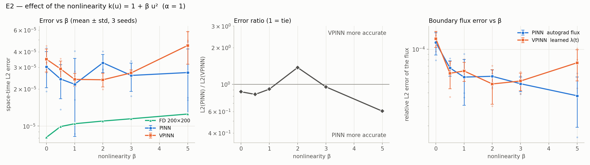
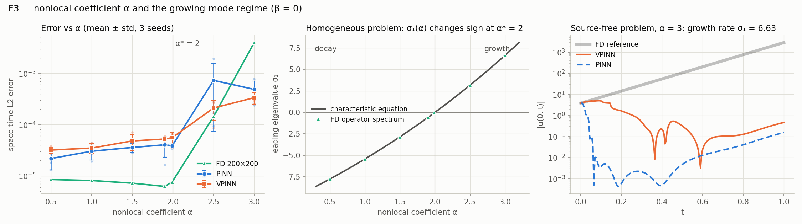
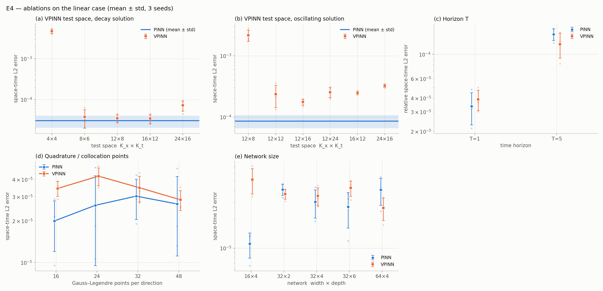
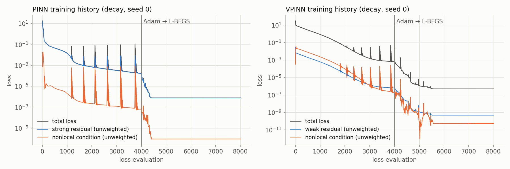

# PINN vs VPINN for Transient Heat Conduction with a Nonlocal Integral Boundary Condition

> A benchmark of Physics-Informed Neural Networks (PINN) and Variational Physics-Informed Neural Networks (VPINN) on the **transient** heat equation with a **nonlocal integral boundary condition** (Cannon-type problem), in the linear and nonlinear (temperature-dependent conductivity) regimes, below and above the critical value of the nonlocal coefficient.

This repository is the transient counterpart of [steady-state-heat-conduction](https://github.com/MaximeAuger/steady-state-heat-conduction) and reuses its conventions: PyTorch, Legendre test functions, boundary flux as a trainable Lagrange multiplier.

[](https://colab.research.google.com/github/MaximeAuger/transient-heat-nonlocal-bc/blob/main/notebooks/transient_heat_nonlocal_bc_colab.ipynb)

**Scope of the claim.** Physics-informed networks have been applied to parabolic problems with nonlocal conditions in strong form (PINN), e.g. for nonlocal *initial* conditions [5]. I am not aware of a variational (VPINN) treatment of a parabolic problem with a nonlocal integral *boundary* condition; a literature search is not a proof of absence.

---

## Problem Statement

$$u_t - \bigl(k(u)\thinspace u_x\bigr)_x = f(x,t), \qquad x \in (0,1),\ t \in (0,T], \qquad k(u) = 1 + \beta\thinspace u^2$$

| Condition | Expression |
|---|---|
| Nonlocal (left) | $u(0,t) = \alpha \int_0^1 u(x,t)\thinspace dx + g_0(t)$ |
| Dirichlet (right) | $u(1,t) = g_1(t)$ |
| Initial | $u(x,0) = u_0(x)$ |

$\beta = 0$ is the linear case. Unless stated otherwise $T = 1$.

### Manufactured Solutions

Both extend the profile of the steady-state benchmark, $\varphi(x) = \sin(\pi x) + (1-x)\thinspace \tfrac{4}{\pi}$, for which $\varphi(0) = \int_0^1 \varphi\thinspace dx = \tfrac{4}{\pi}$:

| Name | Solution | Time dynamics |
|---|---|---|
| `decay` | $u = e^{-t}\thinspace \varphi(x)$ | monotone |
| `oscillating` | $u = \bigl(1 + t + \tfrac12 \sin 2\pi t\bigr)\thinspace \varphi(x)$ | non-monotone |

The data $f$, $g_0$, $g_1$, $u_0$ are derived **symbolically with SymPy** for any $(\alpha, \beta)$ (`src/exact_solution.py`); with $\alpha = 1$ one gets $g_0 = g_1 = 0$, and in general $g_0(t) = u(0,t) - \alpha \int_0^1 u\thinspace dx$. The residual of each manufactured solution is checked independently with PyTorch automatic differentiation (relative residual $\sim 10^{-16}$).

A **source-free problem** without closed-form solution ($f = 0$, $g_0 = g_1 = 0$, $u_0 = \sin \pi x + c\thinspace (1-x)$ with $c$ fixed by compatibility) is used with the finite-difference reference.

### Critical Value of the Nonlocal Coefficient: $\alpha^{\ast} = 2$

For the homogeneous linear problem $u_t = u_{xx}$, $u(1,t) = 0$, $u(0,t) = \alpha \int_0^1 u\thinspace dx$, separated solutions $e^{\sigma t}\phi(x)$ give (`src/critical_alpha.py`, derived with SymPy, not hard-coded):

| Mode | $\phi(x)$ | Condition |
|---|---|---|
| $\sigma = 0$ | $1 - x$ | $\alpha = 2$ |
| $\sigma = \kappa^2 \gt 0$ | $\sinh(\kappa(1-x))$ | $\alpha = \kappa \coth(\kappa/2)$ |
| $\sigma = -\mu^2 \lt 0$ | $\sin(\mu(1-x))$ | $\mu = 2n\pi$ or $\mu \cot(\mu/2) = \alpha$ |

Since $\kappa \coth(\kappa/2) = 2 + \kappa^2/6 - \dots$ is strictly increasing (its derivative is $(\sinh\kappa - \kappa)/(2\sinh^2(\kappa/2)) \gt 0$), **a growing mode exists if and only if $\alpha \gt 2$**, and it is unique. With $z = \mu/2$ the $\alpha$-dependent branch reads $z \cot z = \alpha/2$, the eigen-condition of the self-adjoint Robin problem $-\psi'' = z^2\psi$, $\psi(0) = 0$, $\psi'(1) = \tfrac{\alpha}{2}\psi(1)$: the spectrum is real.

Numerical verification (all in `tests/test_critical_alpha.py`):

- the spectrum of the finite-difference operator is real, its leading eigenvalue matches the characteristic equation for every $\alpha$ tested and changes sign at $\alpha^{\ast} = 2.0000000$ (bisection, $|\alpha^{\ast} - 2| \lt 10^{-10}$);
- Crank–Nicolson integration of the source-free problem reproduces the predicted rate $\sigma_1$: decay for $\alpha = 1$ ($\sigma_1 = -5.43$), growth for $\alpha = 2.5$ ($+3.15$) and $\alpha = 3$ ($+6.63$).

For $\alpha \gt 2$ the problem remains well posed on a finite horizon, but perturbations are amplified by $e^{\sigma_1 T}$ ($\approx 23$ for $\alpha = 2.5$, $\approx 760$ for $\alpha = 3$). The analysis is for the linear problem; no claim is made for $\beta \gt 0$.

---

## Methods

### Shared Setup (identical for both methods)

| Ingredient | Choice |
|---|---|
| Network | MLP $(x,t) \to N_\theta$, 4 hidden layers × 32, tanh, Xavier init, `float64` |
| Initial + Dirichlet conditions | imposed exactly: $u_\theta = u_0(x) + [g_1(t) - g_1(0)] + \tfrac{t}{T}(1-x)\thinspace N_\theta(x,t)$ |
| Points | the same tensor Gauss–Legendre grid, $32 \times 32$ in space-time |
| Nonlocal condition | penalty at the Gauss–Legendre time nodes, integral by the Gauss–Legendre rule in space: $r_I(t_b) = u_\theta(0,t_b) - \alpha \sum_a w_a u_\theta(x_a,t_b) - g_0(t_b)$ |
| Optimiser | Adam (4000 iterations, lr $10^{-3}$) then L-BFGS (4000 loss evaluations, strong Wolfe) |
| Seeds | 0, 1, 2 — every table reports mean ± std |

The two solvers call the same code for the grid, the nonlocal penalty, the optimiser and the metrics (`src/utils.py`); they differ only in how the PDE residual is measured.

### PINN — Strong Formulation

The residual is evaluated at the grid points by automatic differentiation on the flux, as in the steady-state code:

$$r = \partial_t u_\theta - \partial_x\bigl(k(u_\theta)\thinspace \partial_x u_\theta\bigr) - f, \qquad \mathcal{L}_{\text{PINN}} = \overline{r^2} + 100\ \overline{r_I^2}$$

### VPINN — Weak Formulation in Space, Strong in Time

Multiplying by a product test function $v_i(x)\thinspace w_j(t)$ and integrating by parts **in $x$ only** ($v_i(1) = 0$):

$$R_{ij} = \int_0^T\!\!\int_0^1 \bigl(\partial_t u_\theta\thinspace  v_i + k(u_\theta)\thinspace \partial_x u_\theta\thinspace  v_i'\bigr)\thinspace  w_j \thinspace dx\thinspace dt \ -\  v_i(0) \int_0^T \lambda(t)\thinspace  w_j(t)\thinspace dt \ -\  \int_0^T\!\!\int_0^1 f\thinspace  v_i\thinspace  w_j \thinspace dx\thinspace dt$$

- **Test functions:** $v_i(x) = P_i(2x-1) - 1$ (Legendre, $i = 1..K_x$) and $w_j(t) = P_j(2t/T - 1)$ (Legendre, $j = 0..K_t - 1$); default $K_x \times K_t = 12 \times 8$.
- **Boundary flux as a Lagrange multiplier, now a function of time:** $\lambda(t) = -k(u)\thinspace u_x(0,t) = \sum_m c_m P_m(2t/T - 1)$ with trainable $c_m$ ($K_t$ modes).
- Only first derivatives of the network are needed.

$$\mathcal{L}_{\text{VPINN}} = 1000\ \overline{R_{ij}^2} + 100\ \overline{r_I^2}$$

Two deviations from the steady-state code, both stated here because they matter:

1. the test functions are normalised ($v_i / \lVert v_i' \rVert_{L^2}$, $w_j / \lVert w_j \rVert_{L^2}$), so that every weak residual has a comparable scale;
2. the weight of the weak residual is large (1000). Weak residuals are dual-norm quantities, numerically much smaller than strong residuals; with a weight of 1 the VPINN error was $6 \times 10^{-3}$ instead of $3 \times 10^{-5}$.

**Tuning protocol.** One scan of the loss-weight ratio per method on the linear case (seed 0, budget 3000 + 3000): $w_I \in \lbrace 1, 10, 100, 1000\rbrace $ for the PINN, $w_w \in \lbrace 1, 10^2, 10^3, 10^4, 10^5\rbrace $ and three normalisations for the VPINN. The selected weights were then frozen for every experiment.

### Finite-Difference Reference

Crank–Nicolson in time, centred differences in space with $k_{i+1/2} = k\bigl(\tfrac{u_i + u_{i+1}}{2}\bigr)$, the nonlocal row assembled with the trapezoidal rule, Newton iterations for $\beta \gt 0$ (`src/fd_reference.py`). Second-order convergence is verified in `tests/test_fd_reference.py`. It is the reference for the source-free problem ($1600 \times 1600$ grid) and a control everywhere else ($200 \times 200$ grid in the tables).

---

## Results

All numbers below are produced by `python src/run_all.py` and copied from [`results/tables.md`](results/tables.md); every individual run is in [`results/all_runs.csv`](results/all_runs.csv). Errors are absolute unless noted; L2 and L∞ are space-time norms on a $201 \times 201$ grid, H1 is taken at $t = T$.

### E1 — Linear Case ($\beta = 0$, $\alpha = 1$)

**`decay` solution**

| Metric | PINN | VPINN | FD 200×200 |
|---|---|---|---|
| L2 error | 3.03e-05 ± 9.8e-06 | 3.48e-05 ± 7.4e-06 | 8.10e-06 |
| L∞ error | 1.05e-04 ± 4.4e-05 | 9.63e-05 ± 2.1e-05 | 1.37e-05 |
| H1 error at $t = T$ | **1.97e-04 ± 9.9e-05** | 6.53e-04 ± 2.7e-04 | — |
| Nonlocal condition (max over $t$) | 7.20e-05 ± 5.0e-05 | 5.58e-05 ± 3.8e-05 | — |
| Flux $-k u_x(0,t)$ by autograd (rel. L2) | 1.15e-04 ± 2.7e-05 | 5.20e-04 ± 1.2e-04 | 1.71e-04 |
| Flux $\lambda(t)$ learned (rel. L2) | — | 1.25e-04 ± 2.1e-05 | — |
| Training time (s, one CPU thread) | 157 | **79** | 0.13 |

**`oscillating` solution**

| Metric | PINN | VPINN (12 × 8) | FD 200×200 |
|---|---|---|---|
| L2 error | **8.60e-05 ± 2.1e-05** | 2.16e-03 ± 4.4e-04 | 3.73e-05 |
| L∞ error | **4.29e-04 ± 1.9e-04** | 5.41e-03 ± 1.0e-03 | 8.32e-05 |
| H1 error at $t = T$ | **7.42e-04 ± 4.7e-04** | 2.59e-03 ± 5.4e-04 | — |
| Nonlocal condition (max over $t$) | 3.24e-04 ± 2.1e-04 | 2.18e-04 ± 2.8e-05 | — |
| Flux by autograd (rel. L2) | **1.81e-04 ± 4.9e-05** | 1.54e-03 ± 2.8e-05 | 1.74e-04 |
| Flux $\lambda(t)$ learned (rel. L2) | — | 8.44e-04 ± 8.2e-05 | — |
| Training time (s) | 153 | **78** | 0.09 |

- On the monotone solution the two methods are **statistically tied** in L2 and L∞; the PINN is about 3× more accurate in H1; the VPINN costs half the time per iteration (first derivatives only).
- On the non-monotone solution the default VPINN is **25× less accurate**: 8 Legendre modes in time are not enough (see E4a′, where 12 modes bring the gap down to about 2–3×).
- The learned multiplier $\lambda(t)$ is 2–4× more accurate than differentiating the VPINN network, and on the monotone case as accurate as the PINN flux.
- The finite-difference scheme is more accurate than both networks here, for a negligible cost.

<p align="center">
  
</p>

<p align="center">
  
</p>

### E2 — Nonlinearity $k(u) = 1 + \beta u^2$ ($\alpha = 1$, `decay`)

| $\beta$ | PINN L2 | VPINN L2 | Lower mean | PINN flux (autograd) | VPINN flux $\lambda(t)$ | FD 200×200 L2 |
|---|---|---|---|---|---|---|
| 0 | 3.03e-05 ± 9.8e-06 | 3.48e-05 ± 7.4e-06 | PINN ×1.2 (within ±1 std) | 1.15e-04 ± 2.7e-05 | 1.25e-04 ± 2.1e-05 | 8.10e-06 |
| 0.5 | 2.41e-05 ± 7.4e-06 | 2.91e-05 ± 4.6e-06 | PINN ×1.2 (within ±1 std) | 6.74e-05 ± 1.1e-05 | 6.02e-05 ± 1.7e-05 | 9.90e-06 |
| 1 | 2.18e-05 ± 1.4e-05 | 2.39e-05 ± 2.9e-06 | PINN ×1.1 (within ±1 std) | 5.56e-05 ± 2.5e-05 | 6.32e-05 ± 1.3e-05 | 1.04e-05 |
| 2 | 3.26e-05 ± 5.4e-06 | **2.37e-05 ± 3.0e-06** | VPINN ×1.4 | 5.65e-05 ± 8.3e-06 | 4.81e-05 ± 1.7e-05 | 1.10e-05 |
| 3 | 2.57e-05 ± 6.6e-06 | 2.70e-05 ± 1.5e-06 | PINN ×1.0 (within ±1 std) | 4.83e-05 ± 7.3e-06 | 5.12e-05 ± 9.4e-06 | 1.15e-05 |
| 5 | 2.71e-05 ± 1.5e-05 | 4.50e-05 ± 1.3e-05 | PINN ×1.7 (within ±1 std) | 3.75e-05 ± 1.8e-05 | 7.51e-05 ± 2.4e-05 | 1.25e-05 |

**The crossover observed in the 2D steady-state study ($\beta^{\ast} \approx 2.7$) is not reproduced.** In this transient 1D setting both methods stay between $2 \times 10^{-5}$ and $5 \times 10^{-5}$ for every $\beta \in [0, 5]$, and the mean ± std intervals overlap everywhere except at $\beta = 2$ (VPINN ×1.4). The ordering of the means (VPINN ahead at $\beta = 2$, PINN ahead at $\beta = 5$) points in the same direction as the 2D result, but with 3 seeds it is not statistically established. Neither method degrades with $\beta$, unlike the 2D steady case.

<p align="center">
  
</p>

### E3 — Nonlocal Coefficient $\alpha$ ($\beta = 0$, `decay`)

| $\alpha$ | $\sigma_1(\alpha)$ | $e^{\sigma_1 T}$ | PINN L2 | VPINN L2 | Lower mean | FD 200×200 L2 |
|---|---|---|---|---|---|---|
| 0.5 | −7.765 | 0.0004 | 2.18e-05 ± 8.7e-06 | 3.19e-05 ± 4.3e-06 | PINN ×1.5 (within ±1 std) | 8.47e-06 |
| 1 | −5.434 | 0.0044 | 3.03e-05 ± 9.8e-06 | 3.48e-05 ± 7.4e-06 | PINN ×1.2 (within ±1 std) | 8.10e-06 |
| 1.5 | −2.854 | 0.058 | 3.58e-05 ± 7.5e-06 | 4.81e-05 ± 1.7e-05 | PINN ×1.3 (within ±1 std) | 7.21e-06 |
| 1.9 | −0.594 | 0.55 | 4.04e-05 ± 1.7e-05 | 5.23e-05 ± 5.8e-06 | PINN ×1.3 (within ±1 std) | 6.21e-06 |
| 1.99 | −0.060 | 0.94 | 3.86e-05 ± 3.5e-06 | 5.55e-05 ± 1.4e-05 | PINN ×1.4 (within ±1 std) | 7.61e-06 |
| 2.5 | +3.154 | 23.4 | 7.30e-04 ± 8.5e-04 | 2.11e-04 ± 8.9e-05 | VPINN ×3.5 (within ±1 std) | 1.44e-04 |
| 3 | +6.634 | 761 | 4.87e-04 ± 2.2e-04 | 3.35e-04 ± 8.3e-05 | VPINN ×1.5 (within ±1 std) | 3.99e-03 |

- **No degradation when approaching $\alpha^{\ast} = 2$ from below:** the error at $\alpha = 1.99$ is the same as at $\alpha = 1.5$. A neutral mode is not an unstable one, and the horizon is finite.
- **Above $\alpha^{\ast}$ the error jumps by one order of magnitude** for both methods, and the PINN becomes erratic (std larger than the mean at $\alpha = 2.5$). The VPINN has the lower mean, within one std.
- The nonlocal condition itself stays satisfied to $4 \times 10^{-5}$–$10^{-4}$ on both sides of $\alpha^{\ast}$ (see `results/tables.md`): the constraint is met, the error is not small.
- At $\alpha = 3$ the time-marching scheme on a $200 \times 200$ grid is 10× *less* accurate than the networks (its truncation error is amplified by $e^{\sigma_1 T} \approx 760$). It remains second-order convergent, so a finer grid restores its advantage at a cost of seconds.

**Source-free problem, error against the finite-difference reference (1600 × 1600)**

| $\alpha$ | $\sigma_1$ | PINN rel. L2 | VPINN rel. L2 | PINN flux (autograd) | VPINN flux $\lambda(t)$ | FD reference self-error (est.) |
|---|---|---|---|---|---|---|
| 1 | −5.434 | **2.30e-04 ± 5.9e-05** | 1.31e-03 ± 5.0e-04 | 5.69e-03 ± 7.1e-04 | 3.58e-02 ± 3.6e-05 | 2.66e-06 |
| 2.5 | +3.154 | **1.04e-03 ± 2.2e-05** | 8.17e-01 ± 1.1e-01 | 1.08e-03 ± 2.3e-05 | 8.17e-01 ± 1.1e-01 | 2.66e-06 |
| 3 | +6.634 | 1.00e+00 ± 8.8e-05 | 1.00e+00 ± 7.1e-05 | 1.00e+00 ± 5.0e-05 | 1.00e+00 ± 7.3e-05 | 1.47e-05 |

**This is where both methods fail.** With no source term the solution is driven by the growing mode alone (it reaches $|u| \approx 3 \times 10^3$ at $T = 1$ for $\alpha = 3$):

- $\alpha = 2.5$: the PINN follows the growth ($10^{-3}$ relative error), the **VPINN does not** (70–97 % error in the three seeds);
- $\alpha = 3$: **both methods miss the solution entirely** (100 % relative error in all six runs). The trained networks stay $O(1)$ while the reference grows by three orders of magnitude; the final losses ($5 \times 10^{-5}$ to $9 \times 10^{-2}$) are 2–5 orders above those of the runs of E1, and the nonlocal condition is violated by 0.02 to 1.5 on the evaluation grid;
- even in the stable case $\alpha = 1$ the learned flux is off by 3.6 % for the VPINN: this problem has a fast initial transient that 8 Legendre modes in time cannot represent (the std over seeds is 1000× smaller than the error, i.e. the error is a resolution error, not an optimisation one).

A residual-based loss does not see the growing mode: a residual of relative size $e^{-\sigma_1 T}$ at early times is enough to remove it. The likely cause of the VPINN failure at $\alpha = 2.5$ is the under-resolved initial transient being amplified; this explanation was not tested further.

<p align="center">
  
</p>

### E4 — Ablations (linear case)

**E4a — test space $K_x \times K_t$, `decay` solution**

| Test space | Residuals | VPINN L2 | H1($T$) | Flux $\lambda(t)$ |
|---|---|---|---|---|
| 4 × 4 | 16 | 4.69e-03 ± 6.0e-04 | 8.21e-02 ± 1.1e-02 | 3.12e-04 ± 4.3e-05 |
| 8 × 6 | 48 | 3.78e-05 ± 1.8e-05 | 9.76e-04 ± 4.4e-04 | 8.53e-05 ± 4.3e-05 |
| 12 × 8 (default) | 96 | 3.48e-05 ± 7.4e-06 | 6.53e-04 ± 2.7e-04 | 1.25e-04 ± 2.1e-05 |
| 16 × 12 | 192 | 3.42e-05 ± 8.3e-06 | 7.04e-04 ± 3.9e-05 | 1.06e-04 ± 5.0e-06 |
| 24 × 16 | 384 | 7.21e-05 ± 2.0e-05 | 1.39e-03 ± 7.4e-04 | 2.38e-04 ± 9.4e-05 |
| PINN | — | 3.03e-05 ± 9.8e-06 | 1.97e-04 ± 9.9e-05 | 1.15e-04 ± 2.7e-05 (autograd) |

**E4a′ — test space $K_x \times K_t$, `oscillating` solution**

| Test space | Residuals | VPINN L2 | H1($T$) | Flux $\lambda(t)$ |
|---|---|---|---|---|
| 12 × 8 (default) | 96 | 2.16e-03 ± 4.4e-04 | 2.59e-03 ± 5.4e-04 | 8.44e-04 ± 8.2e-05 |
| 12 × 12 | 144 | 2.36e-04 ± 9.3e-05 | 3.50e-03 ± 1.1e-03 | 4.79e-04 ± 1.3e-04 |
| 12 × 16 | 192 | 1.76e-04 ± 2.0e-05 | 3.26e-03 ± 9.0e-04 | 5.50e-04 ± 9.1e-05 |
| 12 × 24 | 288 | 2.54e-04 ± 4.6e-05 | 5.14e-03 ± 2.0e-03 | 6.77e-04 ± 1.1e-04 |
| 16 × 12 | 192 | 2.49e-04 ± 1.6e-05 | 4.93e-03 ± 1.5e-03 | 4.90e-04 ± 1.3e-04 |
| 24 × 16 | 384 | 3.24e-04 ± 2.1e-05 | 5.32e-03 ± 3.4e-04 | 7.46e-04 ± 1.3e-04 |
| PINN | — | **8.60e-05 ± 2.1e-05** | **7.42e-04 ± 4.7e-04** | **1.81e-04 ± 4.9e-05** (autograd) |

**E4b — horizon $T$** (relative space-time L2 error)

| Horizon | PINN | VPINN |
|---|---|---|
| $T = 1$ | 3.39e-05 ± 1.1e-05 | 3.89e-05 ± 8.2e-06 |
| $T = 5$ | 1.51e-04 ± 1.8e-05 | 1.23e-04 ± 3.1e-05 |
| $T = 5$, $K_t = 16$ | — | 1.19e-04 ± 2.5e-05 |

**E4c — Gauss–Legendre points per direction** (L2 error; training time in s)

| $n_x = n_t$ | PINN | VPINN | PINN time | VPINN time |
|---|---|---|---|---|
| 16 | 2.00e-05 ± 8.0e-06 | 3.44e-05 ± 4.2e-06 | 55 | 37 |
| 24 | 2.60e-05 ± 1.7e-05 | 4.23e-05 ± 6.2e-06 | 98 | 57 |
| 32 (default) | 3.03e-05 ± 9.8e-06 | 3.48e-05 ± 7.4e-06 | 157 | 79 |
| 48 | 2.66e-05 ± 1.5e-05 | 2.85e-05 ± 4.7e-06 | 351 | 162 |

**E4d — network size, width × depth** (L2 error)

| Network | PINN | VPINN |
|---|---|---|
| 16 × 4 | **1.11e-05 ± 3.2e-06** | 5.16e-05 ± 1.5e-05 |
| 32 × 2 | 4.07e-05 ± 5.4e-06 | 3.64e-05 ± 4.3e-06 |
| 32 × 4 (default) | 3.03e-05 ± 9.8e-06 | 3.48e-05 ± 7.4e-06 |
| 32 × 6 | 2.69e-05 ± 1.1e-05 | 4.21e-05 ± 7.7e-06 |
| 64 × 4 | 4.04e-05 ± 1.3e-05 | **2.62e-05 ± 6.8e-06** |

- A test space that is too small is fatal (4 × 4), a larger one does not help on the smooth solution and slightly hurts at fixed budget (24 × 16). For the non-monotone solution the number of **time** modes is the limiting factor.
- $T = 5$ multiplies the relative error by 3–5 for both methods; the VPINN has the lower mean, within one std.
- Neither method is sensitive to the number of quadrature points between 16 and 48 per direction, nor (within a factor 2–3) to the network size. Together with the training histories below, this indicates that **the errors are limited by the optimisation, not by the discretisation**: L-BFGS reaches a plateau after roughly 500 (PINN) to 1500 (VPINN) evaluations and progresses very slowly afterwards.

<p align="center">
  
</p>

<p align="center">
  
</p>

### E5 — Extension: Nonlocal Initial Condition (exploratory)

The local initial condition is replaced by a nonlocal one of Sapagovas type, $u(x,0) = \gamma\thinspace u(x,T) + \phi(x)$, **in addition to** the nonlocal boundary condition ($\alpha = 1$, $\beta = 0$, `decay` solution, $\phi$ derived from the manufactured solution). For $\gamma \neq 1$ this condition can also be imposed exactly: writing $u_\theta = A(x) + B_\theta(x,t)$ with $B_\theta = \tfrac{t}{T}(1-x)N_\theta$, the condition gives $A(x) = \bigl[\phi(x) + \gamma\thinspace B_\theta(x,T)\bigr]/(1-\gamma)$, at the price of one extra network evaluation at $t = T$ (`src/network.py`).

| $\gamma$ | PINN L2 | VPINN L2 | Lower mean | PINN H1($T$) | VPINN H1($T$) | PINN flux (autograd) | VPINN flux $\lambda(t)$ |
|---|---|---|---|---|---|---|---|
| 0 (local IC) | 3.03e-05 ± 9.8e-06 | 3.48e-05 ± 7.4e-06 | PINN ×1.2 (within ±1 std) | 1.97e-04 ± 9.9e-05 | 6.53e-04 ± 2.7e-04 | 1.15e-04 ± 2.7e-05 | 1.25e-04 ± 2.1e-05 |
| −1 | 1.46e-05 ± 4.8e-06 | 2.43e-05 ± 7.7e-06 | PINN ×1.7 (within ±1 std) | 1.05e-04 ± 4.0e-05 | 3.93e-04 ± 1.2e-04 | 6.37e-05 ± 2.1e-05 | 8.43e-05 ± 3.0e-05 |
| 0.5 | **2.97e-05 ± 8.9e-06** | 6.67e-05 ± 1.8e-05 | PINN ×2.2 | 2.52e-04 ± 4.1e-05 | 8.18e-04 ± 7.1e-05 | 1.78e-04 ± 5.4e-05 | 1.51e-04 ± 5.6e-05 |
| 2 | **3.94e-05 ± 1.3e-05** | 8.45e-05 ± 2.7e-05 | PINN ×2.1 | 2.14e-04 ± 2.6e-05 | 9.94e-04 ± 3.2e-04 | 2.09e-04 ± 4.0e-05 | 2.15e-04 ± 8.9e-05 |

Both methods handle the two nonlocal conditions together at the accuracy of the local problem; the PINN is about 2× more accurate for $\gamma = 0.5$ and $\gamma = 2$.

**What this experiment is not.** It is not a reproduction of, nor a comparison with, Cabrera Flor & Martín Vaquero [5]: only the abstract of that work could be read, and its exact test problem could not be verified. The setting here (single-point condition in time, combined with an integral boundary condition, hard-imposed) is my own; the form of the condition follows the nonlocal-initial-condition literature, e.g. [6]. The case $\gamma = 1$ is excluded by the ansatz, and no finite-difference reference was built for this extension.

---

## Conclusions

1. **Smooth monotone solution: a tie in accuracy, the VPINN is twice cheaper.** L2 errors of $3.0 \times 10^{-5}$ (PINN) and $3.5 \times 10^{-5}$ (VPINN) are within one standard deviation. The PINN is about 3× better in H1. At equal iteration budget the VPINN takes half the time.
2. **Non-monotone time dynamics favour the PINN.** With the default time test space the VPINN is 25× worse; with enough time modes it is still 2–3× worse.
3. **The time-dependent Lagrange multiplier works.** $\lambda(t)$ recovers the boundary flux to $10^{-4}$–$10^{-3}$ relative error, 2–4× better than differentiating the VPINN network, at no extra cost. It degrades when the time basis is too poor (3.6 % error on the source-free problem).
4. **No crossover in $\beta$.** The VPINN/PINN crossover found near $\beta \approx 2.7$ in the 2D steady-state study does not appear in the transient 1D problem: the two methods are statistically indistinguishable for $\beta \in [0, 5]$, except for a modest VPINN advantage at $\beta = 2$.
5. **$\alpha^{\ast} = 2$ is a sharp boundary for accuracy, but only from above.** Nothing happens when $\alpha \to 2^-$; for $\alpha \gt 2$ errors rise tenfold on the manufactured problem and, on the source-free problem, the VPINN fails at $\alpha = 2.5$ and both methods fail at $\alpha = 3$. Small residuals do not imply small errors in the growing-mode regime.
6. **Neither network method is competitive with finite differences on this 1D problem** in accuracy per unit of computing time: Crank–Nicolson reaches $8 \times 10^{-6}$ in 0.1 s. The interest of the benchmark is methodological (treatment of the nonlocal condition, multiplier $\lambda(t)$, behaviour across $\alpha^{\ast}$), not performance.

### Limitations

- Three seeds per configuration: differences below a factor ≈ 2 are not significant.
- Results are optimisation-limited (L-BFGS plateau); a different optimiser or budget could change the ranking. "Equal budget" means equal numbers of iterations, not equal wall-clock time.
- Loss weights were tuned once, on the linear case with one seed, and the VPINN is sensitive to them.
- One spatial dimension, $T \le 5$, two manufactured solutions and one source-free family.
- E5 is exploratory: one manufactured solution, three values of $\gamma$, no independent reference.
- The stability analysis ($\alpha^{\ast} = 2$) is linear; the interplay with $\beta \gt 0$ was not studied.

---

## Repository Structure

```
.
├── README.md
├── LICENSE
├── requirements.txt
├── src/
│   ├── exact_solution.py     # SymPy-derived problems (manufactured, source-free)
│   ├── critical_alpha.py     # derivation and verification of alpha* = 2
│   ├── fd_reference.py       # Crank-Nicolson reference (Newton for beta > 0)
│   ├── network.py            # MLP + exact initial / Dirichlet conditions
│   ├── utils.py              # quadrature, test functions, nonlocal penalty, optimiser, metrics
│   ├── pinn_solver.py        # strong form
│   ├── vpinn_solver.py       # weak form + lambda(t)
│   └── run_all.py            # all experiments (E1-E5), tables and figures
├── tests/                    # pytest suite
├── notebooks/
│   └── transient_heat_nonlocal_bc_colab.ipynb   # short Colab version
└── results/
    ├── tables.md             # all tables (mean ± std)
    ├── all_runs.csv          # one line per training run
    └── fig1..fig6 *.png
```

## Quick Start

```bash
pip install -r requirements.txt

cd src
python exact_solution.py      # verify the manufactured solutions
python critical_alpha.py      # derive and verify alpha* = 2
python fd_reference.py        # convergence of the Crank-Nicolson reference

python run_all.py --quick     # every experiment, tiny budget, 1 seed (1-5 min depending on the cores)
python run_all.py             # full benchmark -> results/
python run_all.py --only E1,E2 --workers 4
```

**Run time.** The full benchmark is 192 training runs (6.4 core-hours of training in total). With 8 single-thread worker processes on a laptop CPU (Intel Core i5-12450HX, 8 cores, no GPU) it took 49 minutes of wall-clock time: 38 min for E1–E4 (159 runs) and 11.5 min for the oscillating test-space ablation and E5 (33 runs). A single run takes 1.3 min (VPINN) to 2.6 min (PINN) with the default settings. Finished runs are cached in `results/cache/`, so an interrupted benchmark resumes where it stopped. On a 2-core machine (e.g. a free Colab CPU) the full benchmark takes several hours: use the notebook or `--quick` there.

### Tests

```bash
python -m pytest tests -q
```

94 tests (about 1 min): residual of the manufactured solutions (autograd and symbolic), Gauss–Legendre exactness, test functions, vanishing of both discrete losses at the exact solution (including the sign convention of $\lambda(t)$ in the weak form), second-order convergence of the Crank–Nicolson reference, derivation and numerical verification of $\alpha^{\ast} = 2$, exactness of the hard constraints, and short end-to-end trainings.

### Custom Configuration

```python
from pinn_solver import train_pinn
from vpinn_solver import train_vpinn

cfg = {"problem": "oscillating", "alpha": 1.5, "beta": 2.0, "seed": 123}
pinn = train_pinn(cfg)
vpinn = train_vpinn({**cfg, "n_test_x": 12, "n_test_t": 16})

print(pinn["errors"]["L2"], vpinn["errors"]["L2"])
print(vpinn["lam_coeffs"])          # Legendre coefficients of lambda(t)
```

---

## References

Bibliographic data of [1]–[4] and [6]–[9] were checked against Crossref / arXiv records. The status of [5] is stated explicitly.

1. **Cannon, J.R.** (1963). The solution of the heat equation subject to the specification of energy. *Quarterly of Applied Mathematics*, 21(2), 155–160. doi:[10.1090/qam/160437](https://doi.org/10.1090/qam/160437)
2. **Raissi, M., Perdikaris, P. & Karniadakis, G.E.** (2019). Physics-informed neural networks: A deep learning framework for solving forward and inverse problems involving nonlinear partial differential equations. *Journal of Computational Physics*, 378, 686–707. doi:[10.1016/j.jcp.2018.10.045](https://doi.org/10.1016/j.jcp.2018.10.045)
3. **Kharazmi, E., Zhang, Z. & Karniadakis, G.E.** (2021). hp-VPINNs: Variational physics-informed neural networks with domain decomposition. *Computer Methods in Applied Mechanics and Engineering*, 374, 113547. doi:[10.1016/j.cma.2020.113547](https://doi.org/10.1016/j.cma.2020.113547)
4. **Kharazmi, E., Zhang, Z. & Karniadakis, G.E.** (2019). Variational physics-informed neural networks for solving partial differential equations. [arXiv:1912.00873](https://arxiv.org/abs/1912.00873)
5. **Cabrera Flor, A.P. & Martín Vaquero, J.** (2026). Optimization-based schemes to solve PDEs with nonlocal conditions. *The 2nd International Online Conference on Mathematics and Applications (IOCMA 2026)*, 10–12 June 2026, MDPI / Sciforum. <https://sciforum.net/paper/31547> — **Conference abstract and poster; no DOI and no journal version were found. Only the abstract could be read:** it describes a finite-difference residual scheme and a standard PINN for PDEs with nonlocal conditions, with no variational formulation. The exact test problem, its parameters and the reported errors could not be verified, so **no quantitative comparison with this work is made here**.
6. **Martín-Vaquero, J. & Sajavičius, S.** (2019). The two-level finite difference schemes for the heat equation with nonlocal initial condition. *Applied Mathematics and Computation*, 342, 166–177. doi:[10.1016/j.amc.2018.09.025](https://doi.org/10.1016/j.amc.2018.09.025)
7. **Liu, Y.** (1999). Numerical solution of the heat equation with nonlocal boundary conditions. *Journal of Computational and Applied Mathematics*, 110(1), 115–127. doi:[10.1016/S0377-0427(99)00200-9](https://doi.org/10.1016/S0377-0427(99)00200-9)

Further reading on parabolic problems with nonlocal boundary conditions (bibliographic data verified; not used for any quantitative statement above):

8. **Friedman, A.** (1986). Monotonic decay of solutions of parabolic equations with nonlocal boundary conditions. *Quarterly of Applied Mathematics*, 44(3), 401–407. doi:[10.1090/qam/860893](https://doi.org/10.1090/qam/860893)
9. **Ekolin, G.** (1991). Finite difference methods for a nonlocal boundary value problem for the heat equation. *BIT*, 31(2), 245–261. doi:[10.1007/BF01931285](https://doi.org/10.1007/BF01931285)

---

## Citation

```bibtex
@software{auger2026transient_nonlocal,
  author       = {Auger, Maxime},
  title        = {{PINN vs VPINN for Transient Heat Conduction with a
                   Nonlocal Integral Boundary Condition}},
  year         = {2026},
  url          = {https://github.com/MaximeAuger/transient-heat-nonlocal-bc},
  institution  = {FEMTO-ST Institute, Dept. of Applied Mechanics, SUPMICROTECH}
}
```

## License

This project is licensed under the **MIT License** — see [LICENSE](LICENSE) for details.

---

**Author:** Maxime Auger — [FEMTO-ST Institute](https://www.femto-st.fr/), Dept. of Applied Mechanics, ENSMM, Besancon, France.
